<p align="center">
  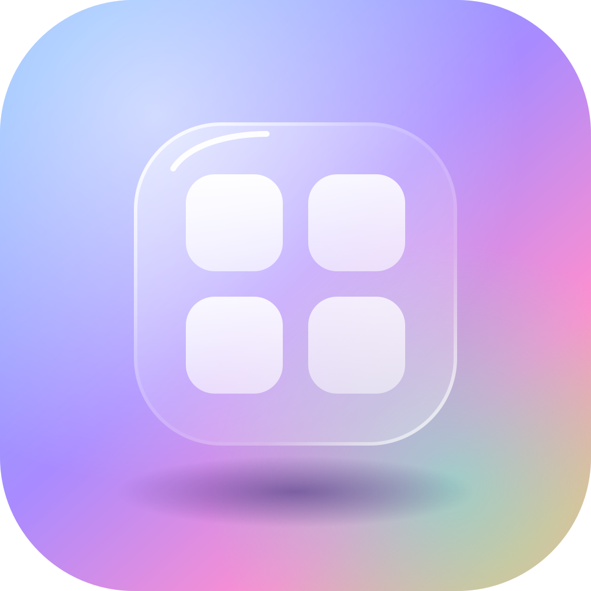
</p>

<h1 align="center">Opaline</h1>

<p align="center">
  An acrylic launcher for your desktop and installed apps.<br />
  Press <kbd>Ctrl</kbd>+<kbd>Alt</kbd>+<kbd>Space</kbd> and your organised Desktop opens over a softened snapshot.
</p>

<p align="center">
  <a href="WORKORDER.md">Work order</a> ·
  <a href="CONTRIBUTING.md">Contributing</a> ·
  <a href="CHANGELOG.md">Changelog</a> ·
  <a href="DEVLOG.md">Dev log</a> ·
  <a href="docs/NAMING.md">Naming</a>
</p>

> **Latest release: [`v0.2.1` "Borosilicate"](https://github.com/MooketsiMagwaza/opaline/releases/tag/v0.2.1).** Windows 11 first; Linux is planned.
>
> The TypeScript build, frontend tests and Rust unit tests are clean locally. Real Windows interaction checks remain open for
> grid reordering and persistence, tray/single-instance, installer and multi-monitor behaviour. The
> [work order](WORKORDER.md#0-current-status) lists every requirement with its real status and only marks something done
> once it has been seen working.

Two-finger swipe and pinch navigation may still feel laggy or miss a short gesture on some trackpads. This remains an open [known issue](WORKORDER.md#13-known-issues); Tab and the Home dots move between Home screens, and Alt+1–5 opens the main pages.

## What it is

You hide the icons on your Windows desktop and keep the files where they are. Opaline reads your Desktop folders and, on
a hotkey, lays them out over a blurred snapshot — your wallpaper, your live wallpaper, your
windows — like a centred home screen. Items are grouped into named **panes**, and a focused Appearance panel controls the acrylic blur and tint.
The bottom taskbar mirror shows pinned and running apps, with cached window previews. A Home button sits beside it; Tab moves between Home screens.

Opaline only **reads** your Desktop. It never moves, renames or deletes your files, and it makes no network requests.

## Features

| | |
|---|---|
| **Consistent acrylic** | One material system covers the launcher, search and transient panels; Appearance exposes direct blur, tint-strength and tint-colour controls. |
| **Centred app grid** | One rounded surface holds the app grid. Drag apps, folders and panes to reorder snapped grid cells; sparse final rows remain left-aligned to the same columns. Loose apps remain plain icon + name, while panes use one rounded mini-icon bubble with the name below. |
| **Paged launcher** | Side arrows, Tab and two-finger left/right swipe move through the Home screens with wraparound. Pinch moves through the Alt+1–5 pages. Both gestures show a live slide preview. The header opens a searchable alphabetical catalogue sourced from Windows AppsFolder, including classic Start-menu and packaged apps. |
| **Your Desktop, organised** | Items come straight from the Desktop folders with their real icons. Panes are virtual — drag a tile onto another to make one, rename it, ungroup it. |
| **Organised for you** | First run sorts IDEs, AI and code agents, dev tools, notes, browsers, chat, creative apps, games, utilities, university folders and code projects into panes. |
| **Search** | Press <kbd>S</kbd> or click search to focus it. Prefix matches first; <kbd>Enter</kbd> launches and arrow keys move around. |
| **Home screens** | Alt+1 opens a read-only view of your Windows Desktop. Tab and Shift+Tab move through simple custom screens. Each custom screen can hold apps, folders and files chosen through Windows app search or a native picker. |
| **Taskbar mirror** | The retained rail now sits at the bottom, with running indicators, focus/restore/launch and cached previews. Ctrl+B collapses page navigation. |
| **Screen time** | Local Today / 7 days / 30 days / All time for foreground maximised apps, with charts, per-app detail and pause/clear controls. |
| **Focus** | Configurable Pomodoro timer, daily progression, shared-acrylic Zen and screen saver views, and rotating break reminders. Automatic saver is opt-in. |
| **Windows key** | Opt-in Windows-key tap opens All apps while Opaline runs. Windows chords and the native Start-button click remain available. |
| **Settings** | A full page for acrylic blur/tint, icon size, behaviour, hotkey and opt-in launch at login. Changes apply as you make them. |
| **Easy to leave** | <kbd>Esc</kbd>, click empty space, click away, or press the hotkey again. A tray icon is always there. |

Feature status lives in the [work order](WORKORDER.md#4-work-packages).

## Preview

Rendered examples use familiar app names and icons with synthetic folders, window contents and screen-time totals. They use the owner's current appearance values; no personal Desktop names or real captures are published.

| Desktop with icons hidden | Opaline Home |
|---|---|
| 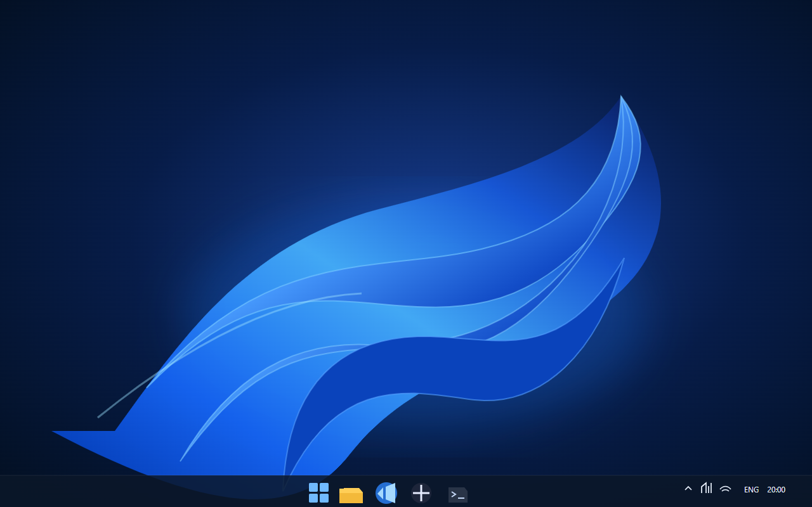 | 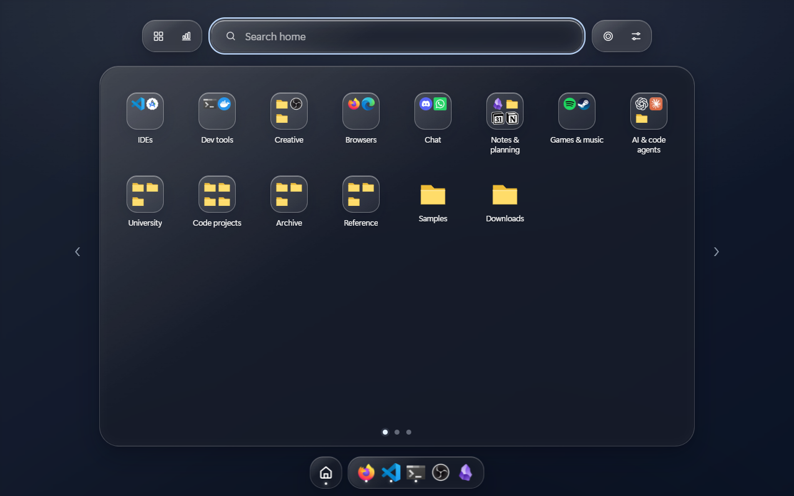 |

The blank desktop is an original illustration based on the owner's example, with no personal wallpaper, notifications or app data.

| All apps | Dev tools Home screen |
|---|---|
| 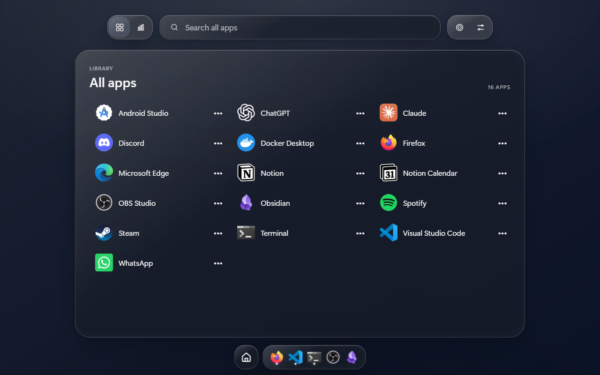 | 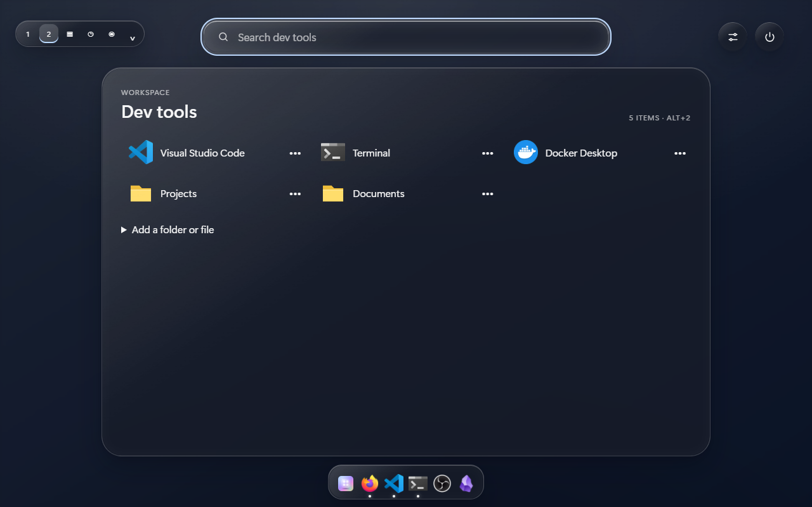 |

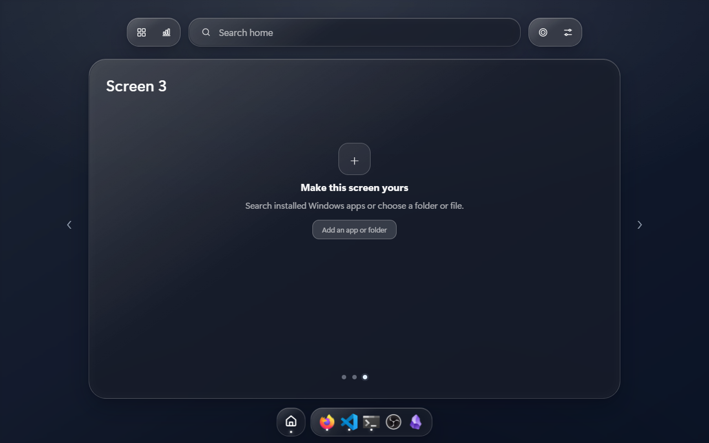

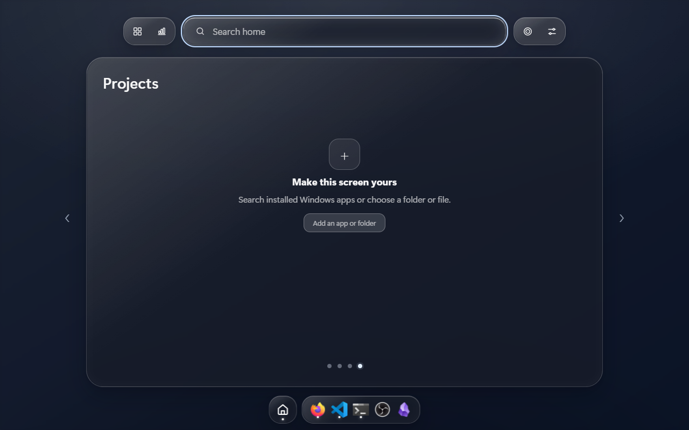

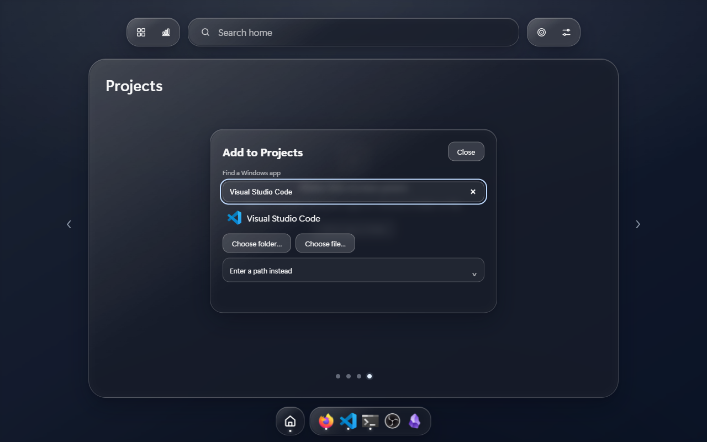

| Screen time | Screen-time progression | Focus timer |
|---|---|---|
| 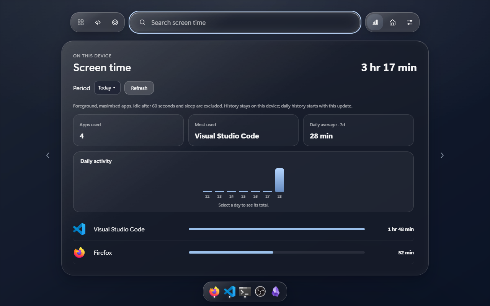 | 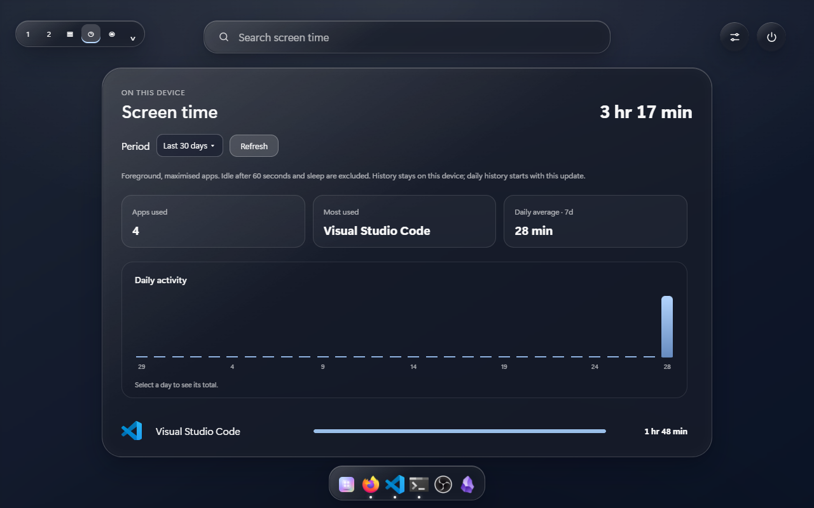 | 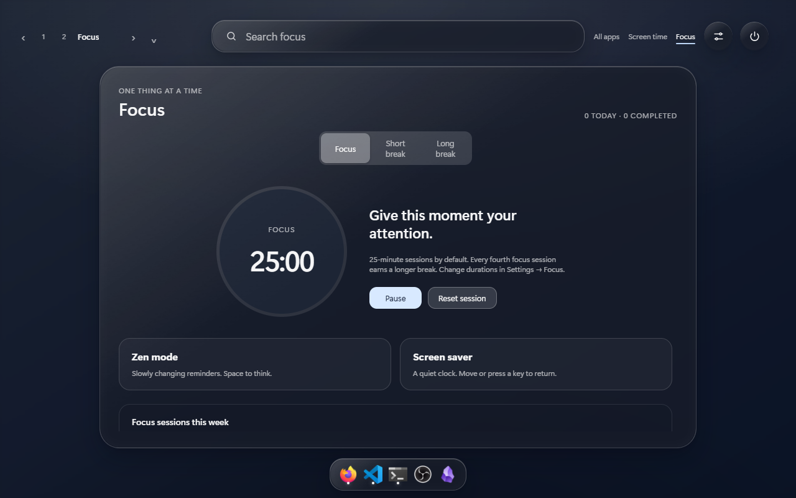 |

| Zen | Screen saver | Settings |
|---|---|---|
| 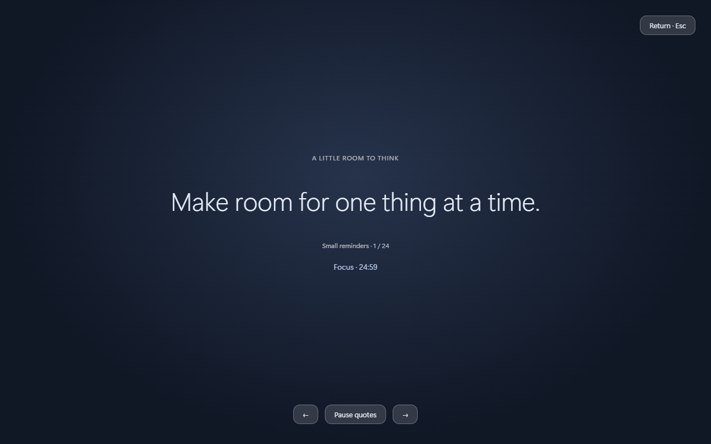 | 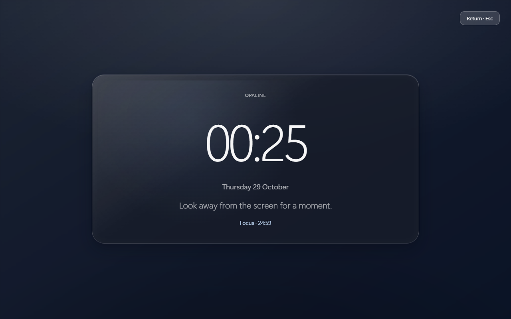 | 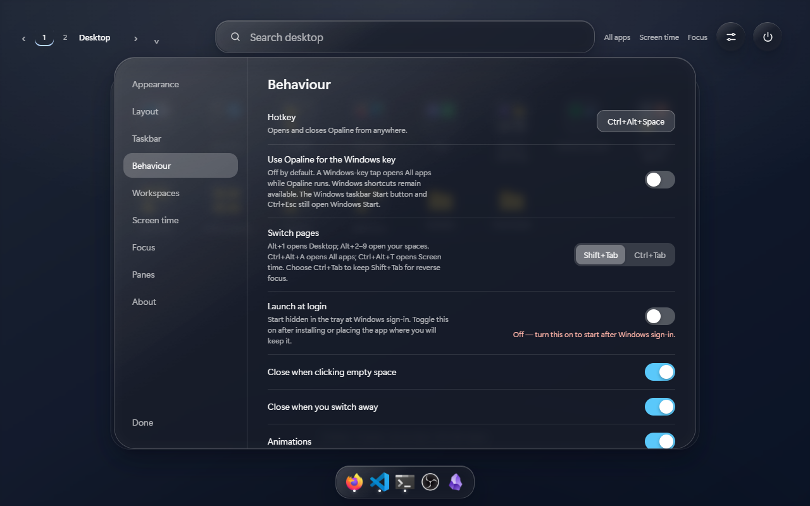 |

[Every Settings section](docs/images/settings-appearance.png): [Layout](docs/images/settings-layout.png) · [Taskbar](docs/images/settings-rail.png) · [Workspaces](docs/images/settings-workspaces.png) · [Screen time](docs/images/settings-screen-time.png) · [Focus](docs/images/settings-focus.png) · [Panes](docs/images/settings-panes.png) · [About](docs/images/settings-about.png).

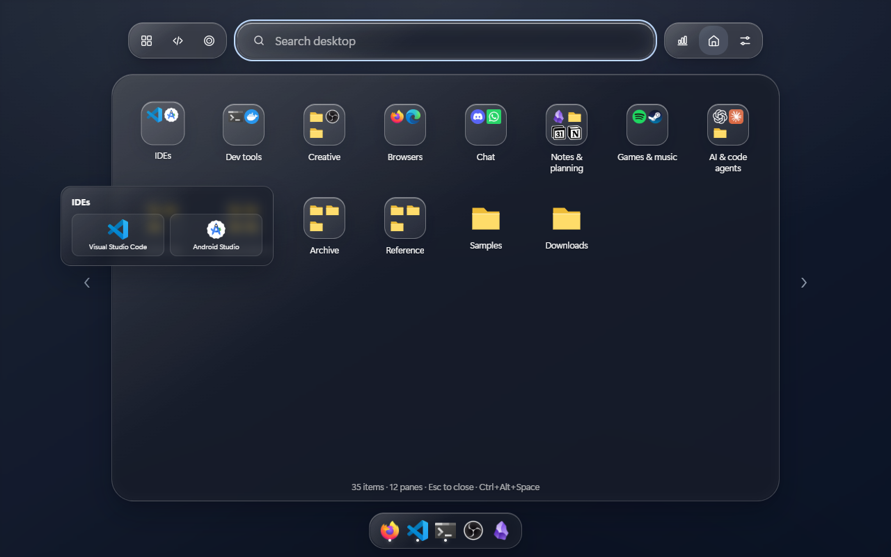

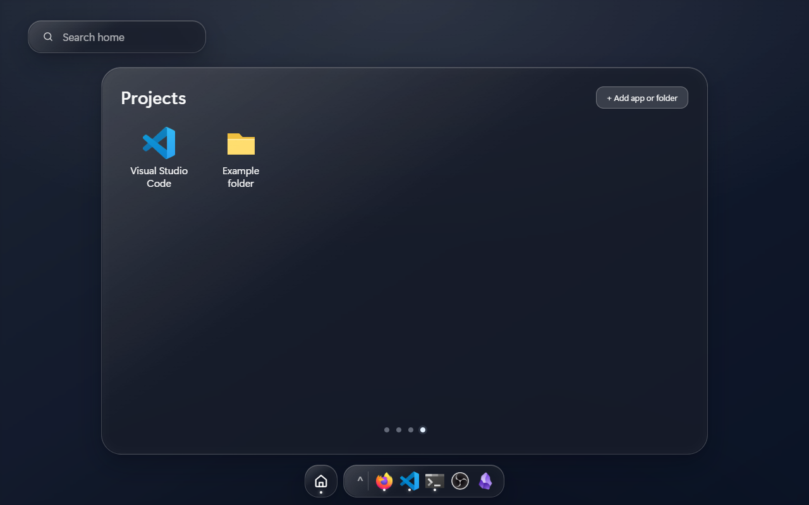

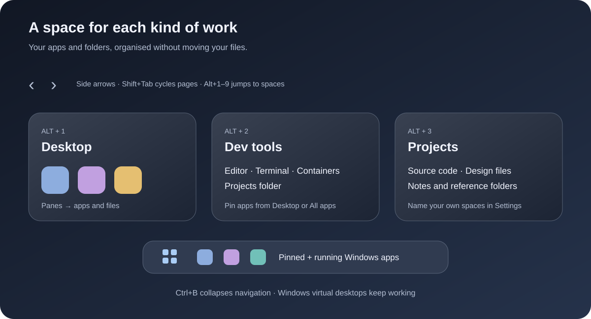

The [session work order](docs/SESSION_WORKORDER.md) lists every requested change, verification evidence and remaining Windows checks. [Design references and image policy](docs/UI_GUIDANCE.md).

## Download

Download the NSIS installer, MSI installer or portable Windows ZIP from the
[latest GitHub release](https://github.com/MooketsiMagwaza/opaline/releases/latest). Installers add **Opaline** to the Start Menu. Release downloads include SHA-256 checksums.

The first public Windows builds are unsigned, so Microsoft Defender SmartScreen may ask for confirmation. Verify the published
`SHA256SUMS.txt` before running a download. Code signing is a release-hardening follow-up, not something the installer bypasses.

To build from source, use the development steps below.

## Quick start (development)

You need Windows 11, [Node.js](https://nodejs.org) 20+, [Rust](https://rustup.rs) (stable) with the MSVC toolchain
(Visual Studio Build Tools, "Desktop development with C++"), and the WebView2 runtime (included in Windows 11).

```bash
npm install
npm run tauri dev
```

Keep the overlay open while you tweak the look (it normally hides when it loses focus):

```bash
# PowerShell
$env:OPALINE_PIN = "1"; npm run tauri dev
```

Build an installer:

```bash
npm run tauri build
```

The release process and artifact list are documented in [docs/RELEASING.md](docs/RELEASING.md).

> **Windows path-length gotcha.** If the repo lives in a deeply nested folder, Cargo's build scripts can fail to link
> (`LNK1104`) because paths pass 260 characters. Point the build output somewhere short:
> `$env:CARGO_TARGET_DIR = "$env:LOCALAPPDATA\opaline-target"`.

## Using it

| Key | Does |
|---|---|
| <kbd>Ctrl</kbd>+<kbd>Alt</kbd>+<kbd>Space</kbd> | Open / close (rebindable in Settings) |
| <kbd>S</kbd> | Focus search without entering a character |
| <kbd>Enter</kbd> | Launch the top result |
| <kbd>S</kbd>, then <kbd>↓</kbd> | Move from search into tiles |
| <kbd>Esc</kbd> | Clear search → close pane/menu/settings → close Opaline |
| Click empty space | Close |
| Right-click a tile | Open · file location · copy path · add to / remove from pane · rename · ungroup |
| <kbd>Ctrl</kbd>+<kbd>Q</kbd> | Quit |
| <kbd>Alt</kbd>+<kbd>1</kbd>–<kbd>5</kbd> | Home / All apps / Screen time / Focus / Settings |
| <kbd>Tab</kbd> / <kbd>Shift</kbd>+<kbd>Tab</kbd> | Next / previous Home screen |
| <kbd>Ctrl</kbd>+<kbd>Tab</kbd> / <kbd>Ctrl</kbd>+<kbd>Shift</kbd>+<kbd>Tab</kbd> | Next / previous top-level page |
| <kbd>Ctrl</kbd>+<kbd>Alt</kbd>+<kbd>A</kbd> / <kbd>T</kbd> / <kbd>F</kbd> | All apps / Screen time / Focus |
| <kbd>Ctrl</kbd>+<kbd>B</kbd> | Collapse / expand navigation |

Use the side arrows, Tab or a two-finger horizontal swipe on Home to move between the Desktop and custom screens. Home swipes wrap in both directions and have no page-navigation action outside Home. Pinch inward to go to the previous Alt+1–5 screen; spread outward to go to the next. Ctrl+Tab also cycles the five main screens. The header puts **All apps** and **Screen time** left of search, with **Focus** and **Settings** on the right. **Home** sits beside the bottom taskbar, which shows only pinned and running apps. Hover a pane or folder for half a second to peek at its icon grid. The Windows AppsFolder catalogue begins loading in the background after startup; the first visible frame does not wait for it.

## Works well with

- **Live wallpapers** — [Wallpaper Engine](https://www.wallpaperengine.io) (paid, biggest library) or
  [Lively Wallpaper](https://github.com/rocksdanister/lively) (free, open source). Opaline snapshots what is on
  screen, so both just work. The wallpaper is frozen in the snapshot while the overlay is open.
- **A transparent taskbar** — a tool such as TranslucentTB. Opaline does not modify the taskbar.
- **Hidden desktop icons** — Windows: right-click the desktop → *View* → untick *Show desktop icons*.

## Where things live

| | |
|---|---|
| Panes, grid order and launch counts | `groups.json` in the app data folder (`%APPDATA%\io.github.mooketsimagwaza.opaline`) |
| Hotkey | `config.json`, same folder |
| Look & behaviour settings | the webview's local storage (`opaline.settings`) |
| Named Home screens and pinned items | `workspaces.json`, same app data folder |
| Local screen time / Windows-key preference | `screen-time.json` / `shell.json`, same app data folder |

Delete `groups.json` to start over; Opaline will organise your desktop again on the next open.

Screen time starts while Opaline runs. Only the foreground maximised app counts; background/minimised windows, idle periods after 60 seconds and sleep gaps do not. Apps sharing a legacy Windows host can be combined under that executable. Screen time stores app identity and totals, not window titles or browsing history.

WebView2 is the Windows UI engine used by Tauri. Its processes are children of Opaline even when Task Manager groups them separately under Microsoft Edge WebView2. See [architecture](docs/ARCHITECTURE.md#processes-on-windows).

## Project layout

```
src/                 TypeScript + CSS UI (overlay, panes, All Apps, settings, acrylic)
src-tauri/src/       Rust: hotkey, window lifecycle, capture, AppsFolder, icons, taskbar, store
scripts/             make-icons.mjs (logo → app icons) · cdp.mjs (drive the running app for testing)
archive/winui3-beta  The failed first attempt, kept for reference (see DEVLOG.md)
assets/              Logo
docs/                Architecture, testing, releasing, roadmaps and agent handoff
AGENTS.md            Guide for coding agents (also a good orientation for people)
```

## Roadmap

See [WORKORDER.md](WORKORDER.md) §4 and §11. Widgets, calendar and an opt-in Start-style surface remain future work in
[docs/PLATFORM_ROADMAP.md](docs/PLATFORM_ROADMAP.md). The current visual target is the single acrylic system described in
[docs/THEME_WORKORDER.md](docs/THEME_WORKORDER.md).

## Contributing

Contributions are welcome — read [CONTRIBUTING.md](CONTRIBUTING.md) first. Please follow the
[code of conduct](CODE_OF_CONDUCT.md); report security issues as described in [SECURITY.md](SECURITY.md).

## License

[MIT](LICENSE).
