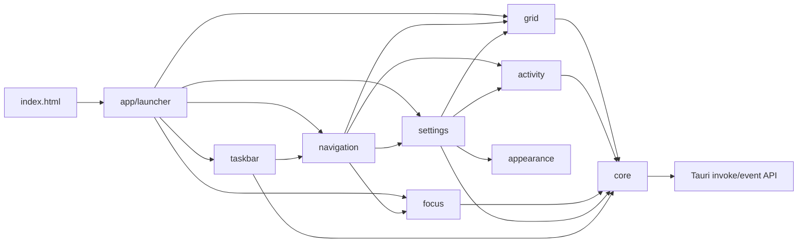
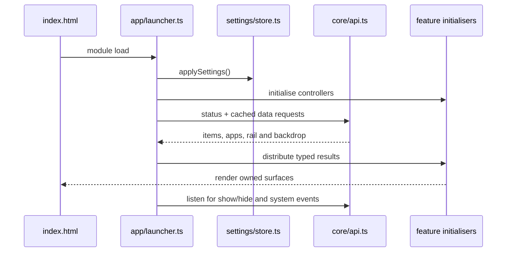

# Frontend architecture

Opaline is a framework-free TypeScript frontend organised by runtime ownership. The `src` root intentionally contains no runtime modules:
every implementation belongs to the application composition layer, shared core, or one feature folder.

## Directory map

| Folder | Owns | May depend on |
| --- | --- | --- |
| `app/` | boot, overlay lifecycle, global input and shared shell CSS | every feature and `core/` |
| `core/` | typed Tauri boundary, DOM helpers, icons, menus and reusable glass primitive | Tauri API; `settings/store.ts` only for glass parameters |
| `appearance/` | built-in materials and versioned user visual profiles | settings types |
| `activity/` | screen-time loading, filtering, charts and duration formatting | core only |
| `focus/` | timer state machine, Focus page, ambient/quiet modes and CSS | core, activity date helpers, settings |
| `grid/` | Home tiles, panes, groups, workspaces, organisation, drag/drop and peeks | core and settings |
| `navigation/` | top-level pages, Home-screen routing, swipe/pinch recognition and navigation CSS | grid, activity, focus and settings adapters |
| `settings/` | validated settings store, staged editor, live launcher simulation and settings CSS | feature public APIs |
| `taskbar/` | running/pinned app rail, thumbnail cache and hover preview lifecycle | core, settings and navigation |

## Dependency graph

Feature modules must not import `app/`. Cross-feature calls use the owning feature's public exports; native commands go through
`core/api.ts`. CSS follows the same ownership rule: feature selectors live beside the feature, while only shell geometry and shared tokens
remain in `app/launcher.css`.

## Startup and state flow

## State ownership rules

- Persisted visual and behaviour settings live only in `settings/store.ts`.
- Pane membership, launch counts and manual Home positions live in `grid/groups.ts`.
- Named Home screens live in `grid/workspaces.ts`.
- Timer transitions stay pure in `focus/timer.ts`; DOM orchestration belongs in `focus/index.ts`.
- Settings edits are drafts until Done. Hotkey and launch-at-login operations are explicit immediate OS actions.
- Backdrop pixels and window thumbnails are memory-only and are never included in exported visual profiles.

## Verification map

- `npm test` covers pure timer, settings normalisation, pane/group persistence, workspaces, organisation rules and drop geometry.
- `npm run build` type-checks every ownership boundary and produces the Vite bundle.
- `scripts/verify-ui.mjs` drives the actual frontend with isolated native fixtures, including staged settings, live simulations and gesture tails.
- Rust tests and `scripts/verify-native.mjs` cover the native command boundary separately.

Each feature README documents its public API, internal data flow, invariants and extension points. Native architecture and performance budgets
remain in `docs/ARCHITECTURE.md`.
