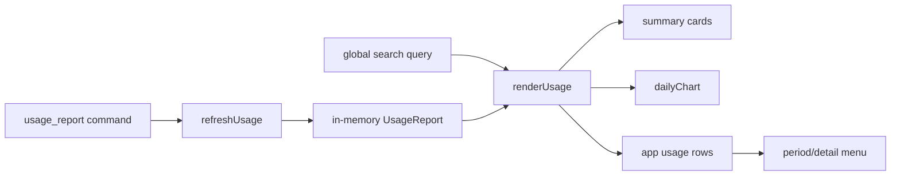

# Activity / Screen time feature

Owns local usage-report presentation and reusable daily charts.

- `index.ts` loads `UsageReport`, filters it, computes summaries, renders app rows and exposes `initUsage`, `refreshUsage`, `renderUsage` and
  `setUsageQuery`.
- `charts.ts` contains local-date keys, recent-day ranges, the value axes (`timeAxis` for durations, `countAxis` for counts; round steps, at
  most four intervals, unit-tested) and the accessible daily bar-chart renderer, which draws the axis, faint rules, dated and weekday-labelled
  days and marks today. Focus reuses only these helpers; it does not depend on Screen time state.
- `activity.css` owns insights, charts, toolbars and usage rows.

The frontend does not infer activity by polling windows. App names and icons arrive already resolved by the native `identity.rs` (see `docs/ARCHITECTURE.md`), so this feature never maps executables or package hosts itself. Native collection and persistence policy stay behind `core/api.ts`; this feature
only renders the returned report. Refresh errors must preserve the last valid report and show status rather than clearing the page.

