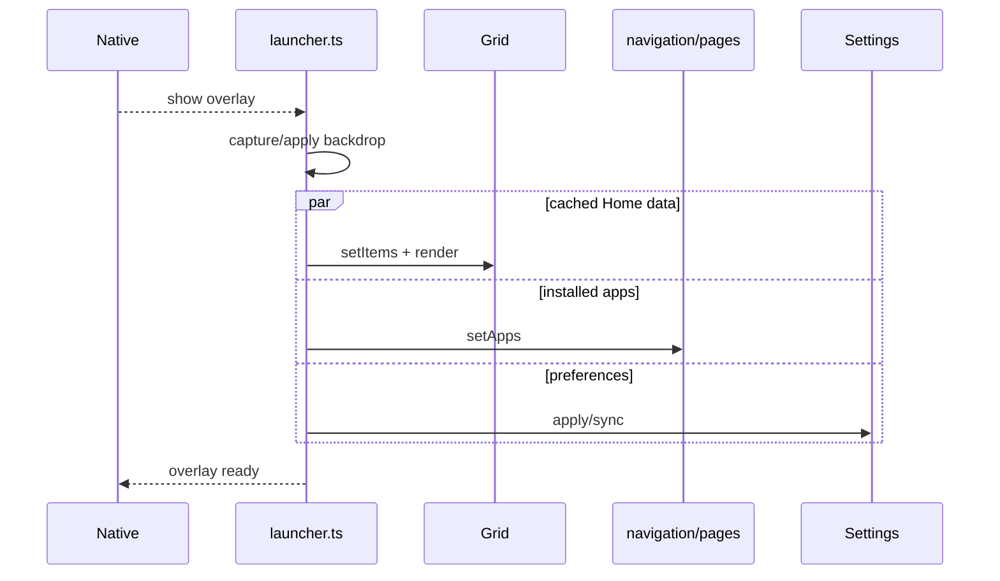

# Application composition

`launcher.ts` is Opaline's composition root. It wires feature initialisers, distributes native data, owns overlay show/hide, and handles
global shortcuts that cross feature boundaries. It must coordinate features rather than implement their internal rules.

`launcher.css` owns global tokens, shell geometry and shared surface primitives. Feature-specific selectors are imported from the owning
folder. Moving a feature rule back into this file requires a cross-feature reason.

The composition root may import every feature. Features must not import it. Expensive app enumeration, taskbar refresh and thumbnail warming
remain deferred so cached Home content can appear first.

