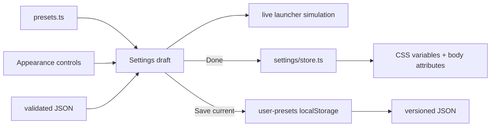

# Appearance feature

Owns complete material recipes and portable user-created visual profiles.

## Data model

`presets.ts` defines the appearance-only slice of `Settings` and six built-in recipes. A recipe includes material profile, backdrop blur,
saturation/brightness, tint, pane blur, corner radius, tile glass and custom surface colour/opacity. Built-ins are values, not special-case
rendering code; selecting one stages the same settings a user can tune manually.

`user-presets.ts` expands the captured slice to visual layout choices such as panel width, taskbar visibility and navigation arrangement. It
validates versioned JSON imports, limits local profiles to 24, and exports no wallpaper, icons or thumbnails.

`appearance.css` owns preset/profile cards; actual material behavior is shared with launcher surface CSS. When adding a material, add its
typed profile, full preset values, applied surface rules, simulation rules and uniqueness tests together. Profiles remain entirely local and
make no network calls.
