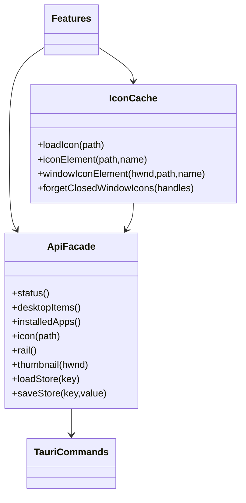

# Shared core

Core contains the smallest reusable layer beneath features.

- `api.ts` is the typed frontend facade over Tauri commands. Features never call `invoke` directly.
- `dom.ts` contains framework-free element, lookup, timing and numeric helpers.
- `icons.ts` deduplicates concurrent icon requests and caches decoded data URLs, with explicit failed/closed-entry eviction.
- `menu.ts` owns the shared contextual menu and nested menu interaction.
- `glass.ts` contains the optional reusable refraction lens primitive.

Core must not contain product workflow state. If a helper is used by only one feature, it belongs with that feature. Native results should be
typed here, while validation of persisted feature state remains in the feature that owns it.

