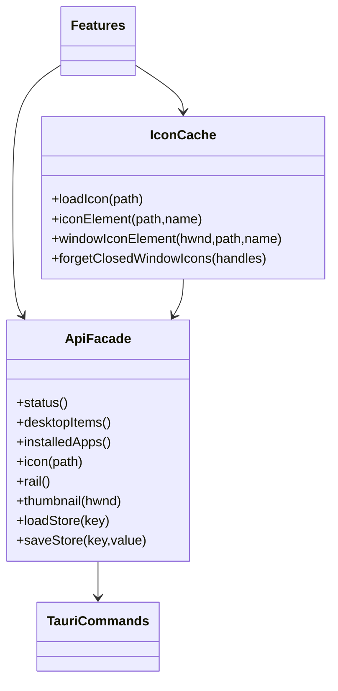

# Shared core

Core contains the smallest reusable layer beneath features.

- `api.ts` is the typed frontend facade over Tauri commands. Features never call `invoke` directly.
- `dom.ts` contains framework-free element, lookup, timing and numeric helpers.
- `icons.ts` deduplicates concurrent icon requests and caches decoded data URLs, with explicit failed/closed-entry eviction.
- `menu.ts` owns the shared contextual menu and nested menu interaction.
- `hover-intent.ts` holds the shared hover rules: `PathGuard` (point-in-triangle corridor plus a distance turn-back test), `Closer` (a grace
  timer re-evaluated on every pointer move) and `HoverGroup` (a cold delay for the first popup, none once one is open or just closed).
- `motion.ts` decides whether motion may play (Animations on, no reduced-motion preference) and provides `fadeIn`, the shared ease-in used by pages and
  Settings sections.
- `refraction.ts` is the pure physics of a glass edge: a convex squircle surface, Snell's law (glass index 1.5) and the sideways shift it
  gives a ray, sampled across the bezel. Unit-tested.
- `glass.ts` is the lens. When a material asks for refraction (the Light bending setting) it gives each large panel and
  control an SVG filter whose displacement map comes from `refraction.ts`, applied once per colour channel with a slightly different
  strength (dispersion) through `backdrop-filter: url(#…)`, so the desktop is bent at the edges instead of only blurred. Chromium (WebView2)
  only, GPU-heavy, and absent entirely, not merely idle, when refraction is 0.

## Hover intent

Popups that open on hover (context-menu submenus, the taskbar preview, the pane peek and the navigation tray) share three rules:

1. **Follow the path.** When the pointer leaves the trigger, a popup stays open while the pointer is inside the triangle from its exit point
   to the popup's near edge, and while the Pythagorean distance to the popup keeps shrinking. A diagonal path that crosses a neighbouring
   row or icon therefore does not close or replace it. Turning back, stalling or leaving the corridor ends the grace period.
2. **Warm up.** The first popup waits its normal delay; once one is open (or closed within 450 ms) neighbouring triggers open at once, so
   sweeping along a dock or grid feels continuous.
3. **Mouse only.** Touch and pen keep their existing tap behaviour.

`PathGuard` is pure geometry and unit-tested in `tests/hover-intent.test.ts`; the real-mouse paths are exercised by `scripts/verify-ui.mjs`.

Core must not contain product workflow state. If a helper is used by only one feature, it belongs with that feature. Native results should be
typed here, while validation of persisted feature state remains in the feature that owns it.

