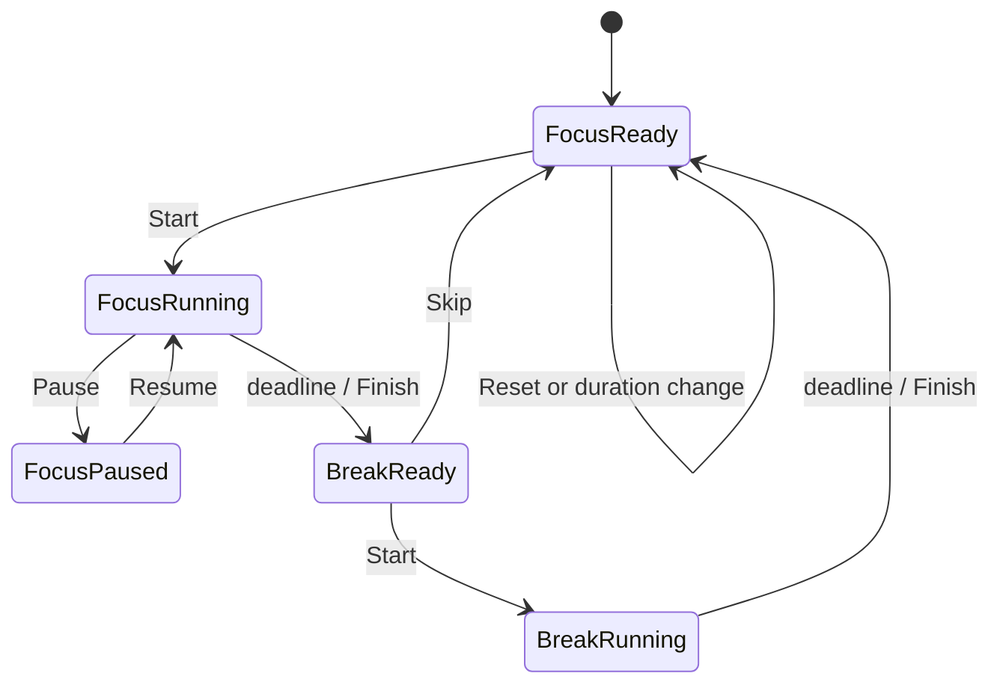

# Focus feature

Owns focus sessions, break rotation, completion history, compact timer state and the immersive/quiet presentations.

## Modules

- `timer.ts` is a pure deadline-based state machine. It restores untrusted persisted values and exposes start/pause, settle, finish, skip and
  reset transitions without touching the DOM.
- `index.ts` binds timer state to the Focus page, local persistence, duration and break preferences, daily chart and compact capsule.
- `ambient.ts` owns Immersive Focus and the idle-triggered Quiet Clock, including keyboard dismissal and quote rotation.
- `content.ts` contains editable labels, reminders and saver prompts. `focus.css` owns the page and both ambient modes.

## Timer model

Every fourth completed focus session selects a long break; other completions select a short break. `endsAt` is authoritative while running,
so hiding or suspending the WebView does not pause elapsed time. Daily completion keys come from `activity/charts.ts` to keep local-date
handling consistent with Screen time.

## Native boundary and invariants

Native idle detection remains in `src-tauri/src/idle.rs`; the frontend only decides whether the enabled Quiet Clock should open. Ambient
modes must never alter Windows lock/sign-in settings. Timer persistence contains intention and timing state only, and no network calls are
made. New timer behavior belongs in the pure module with unit tests before UI wiring is added.

The expandable Focus preferences card owns short/long break duration, Zen quote interval, automatic Quiet Clock and idle delay. These are
not duplicated in general Settings.
