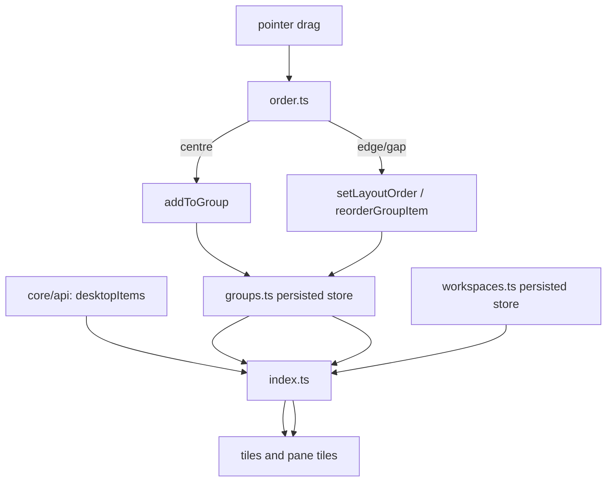

# Grid and Home feature

Owns everything displayed *inside* Home: Desktop tiles, panes, named Home screens, item picking, ordering and read-only peeks. It never moves,
renames or deletes real Desktop files.

## Modules and public surface

- `index.ts` coordinates rendering, search, tile activation, pane popups and keyboard movement. Main exports: `setItems`, `render`, `sortHome`,
  `openGroup`, `closePopup`, `focusFirstTile` and `handleArrow`.
- `groups.ts` owns the persisted pane/group store, launch counts and absolute manual layout positions.
- `workspaces.ts` owns named Home screens and their pinned app/folder entries.
- `drag.ts` owns one drag session, insertion markers and drop routing for Home and pane grids.
- `order.ts` is the pure geometry layer that separates centre-to-group from edge-to-insert.
- `organize.ts` applies the ordered, editable definitions in `organize-rules.ts` without touching already-grouped items.
- `item-picker.ts` owns the add-to-screen dialog and installed-app/path selection.
- `peek.ts` owns delayed, read-only pane/folder previews. `grid.css` owns every visual state above.

## Data and interaction flow

## Invariants

- Reordering items inside a pane changes only that pane's item array; automatic sorting is not applied internally.
- A centre drop groups; edge and inter-tile gaps reorder. Feedback must match the active theme.
- Persisted paths are treated as identifiers, not permission to mutate the filesystem.
- Search may filter the rendered view but must not overwrite saved order.
- Store writes are debounced and normalised when loaded; missing Desktop entries are pruned explicitly.

## Dependencies and extension points

The feature depends on `core/api`, `core/dom`, `core/icons`, `core/menu` and read-only settings. Navigation consumes the public grid API. New
automatic categories belong in `organize-rules.ts`; new drop meanings belong in `order.ts` plus unit tests, not inline pointer handlers.
