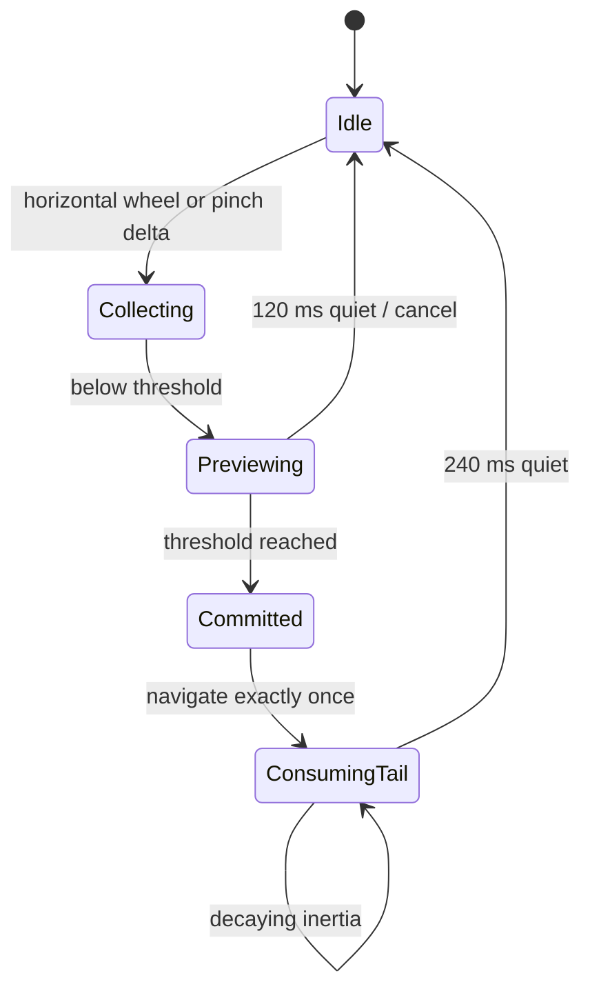

# Navigation feature

Owns page routing, Home-screen routing, keyboard recovery paths, visual destination arrangements and physical swipe/pinch recognition.

## Modules

- `pages.ts` is the page controller. It renders All apps and named Home screens, synchronises search, and exposes `show`, `cycle`,
  `cycleHome`, `selectPage`, `previewGesture` and `completeGesture`.
- `gestures.ts` contains `PageGestureController`, a single recogniser for precision-touchpad wheel input and two-touch pointer input.
- `navigation.css` owns Split Header, Navigation Taskbar, Dropdown Tray, overflow and applied visibility rules.

## Gesture state machine

The committed-tail branch runs before page availability checks. This is intentional: view transitions temporarily block navigation, but
their incoming inertial wheel events still belong to the already-committed swipe and must be consumed. `pages.ts` also clears the transition
lock after at most 280 ms because WebView2 can otherwise leave `ViewTransition.finished` pending until pointer movement requests a frame.

## Routing rules

- Horizontal swipes route only between Home screens and wrap at both ends.
- Pinch routes through the five top-level destinations.
- Alt+1–5 is always available regardless of visual arrangement or pin state.
- Split Header places destinations around search; Navigation Taskbar moves them beside Home; Dropdown Tray keeps them behind one trigger.
- Unpinned destinations remain in overflow, and Settings always has a keyboard recovery path.

`pages.ts` depends on feature public APIs because it coordinates their top-level surfaces. No feature may import the application launcher.
