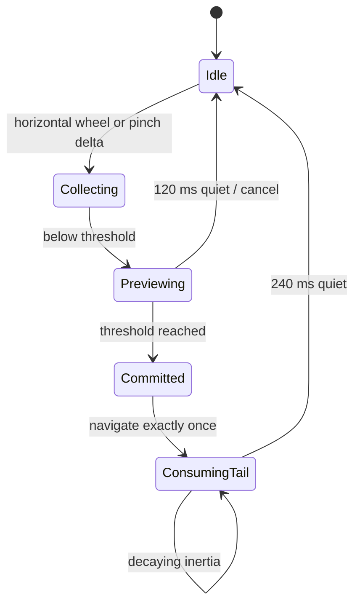

# Navigation feature

Owns page routing, Home-screen routing, keyboard recovery paths, visual destination arrangements and physical swipe/pinch recognition.

## Modules

- `pages.ts` is the page controller. It renders All apps and named Home screens, synchronises search, and exposes `show`, `cycle`,
  `cycleHome`, `selectPage`, `previewGesture` and `completeGesture`.
- `gestures.ts` contains `PageGestureController`, a single recogniser for precision-touchpad wheel input and two-touch pointer input.
- `gesture-motion.ts` owns what a gesture looks like: the live preview while it is held, and the commit animation when it lands.
- `tray.ts` makes the Dropdown Tray behave as a dropdown (hover to open, path-aware close, click to pin, outside press or Escape to dismiss).
- `navigation.css` owns Split Header, Navigation Taskbar, Dropdown Tray, overflow and applied visibility rules.

## Gesture state machine

The committed-tail branch runs before page availability checks. This is intentional: the incoming inertial wheel events of a swipe that
already navigated still belong to it and must be consumed rather than start a second page change. Motion in flight never blocks the next
gesture: a new preview or navigation ends the running transition first (`endTransition()`), and a 1.5 s safety timer clears a stalled one.

## Gesture motion

The preview is driven only by three custom properties on the element being moved — `--gesture-dir` (±1), `--gesture-p` (eased 0..1) and
`--gesture-fade` — and the CSS in `navigation.css` maps them to `transform` and `opacity`. Nothing else animates while a gesture is held, so
it stays on the compositor and cannot clip or relayout.

- **Swipe** slides only the Home content (`.home-motion`) over stationary glass, 56 px at full progress. Home with a single screen
  rubber-bands (resistance 0.22) and springs back instead of previewing a page that does not exist.
- **Pinch** zooms the whole page surface (±7.5 %) with a fade, then cross-zooms into the destination: the outgoing page scales away while
  the incoming one scales up from slightly small.
- A floating cue (`#gesture-cue`) names the destination while the gesture is held.
- On commit the app navigates **immediately** and `playCommit` cross-animates a ghost clone of the outgoing page with the Web Animations
  API (named `gesture-out`/`gesture-in`), so the real page is always the live, interactive one. The clone keeps its ids because the
  stylesheet is id-keyed, is appended last in `#shell` so `getElementById` still finds the real page, and a swipe ghost hides its glass so
  only the content moves.
- View Transitions are deliberately not used: they morph geometry, clip differently and can stall in WebView2 until the pointer moves.
- Reduced motion and `data-anim="false"` remove the movement but keep the destination cue.

## Routing rules

- Horizontal swipes route only between Home screens and wrap at both ends.
- Pinch routes through the five top-level destinations.
- Alt+1–5 is always available regardless of visual arrangement or pin state.
- Split Header places destinations around search; Navigation Taskbar moves them beside Home; Dropdown Tray keeps them behind one trigger.
- Unpinned destinations remain in overflow, and Settings always has a keyboard recovery path.

`pages.ts` depends on feature public APIs because it coordinates their top-level surfaces. No feature may import the application launcher.
