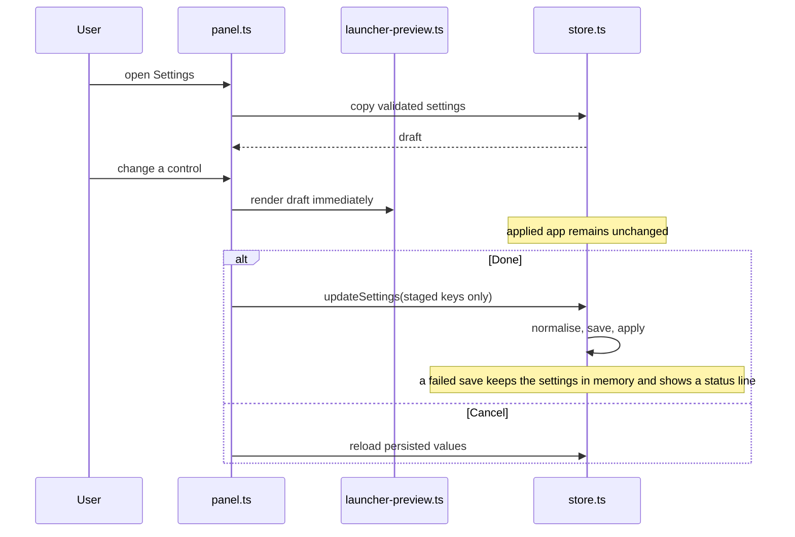

# Settings feature

Owns settings validation, persistence, the staged editor and previews shown only where they explain the active task.

## Modules

- `store.ts` defines `Settings`, defaults, normalisation, persistence and `applySettings`. It is the sole writer of applied CSS variables and
  body data attributes.
- `panel.ts` defines the information architecture and control builders. It owns draft state, section navigation and Done/Cancel.
- `draft.ts` holds the pure draft rules: which keys the user staged (`stagedChanges`) and how a change made elsewhere, such as Ctrl+B, is
  folded into an open draft (`absorbLiveChanges`). Done applies only the staged keys, so it can never revert a live change.
- `launcher-preview.ts` creates an isolated 1280×800 frame from the real Home DOM and the already-loaded app stylesheet, then applies the
  draft settings inside that frame. Reusing in-memory CSS avoids a network request per simulation. It is real launcher composition rather
  than substitute preview artwork. A loaded preview is updated in place (`updateLauncherPreview` changes only the root variables and body
  attributes), so a slider tick never reloads a document; the panel rebuilds previews only when Settings opens or after a live change. Backdrop
  data URLs are shared through an in-memory blob URL (never persisted).
- `help.ts` renders the Shortcuts & help section from `data/shortcuts.ts`, the single list of keys and gestures. Change it with
  `app/launcher.ts`'s key handling.
- `settings.css` and `launcher-preview.css` own editor and simulation styling.

## Draft transaction

## Information architecture

- **Appearance:** backgrounds, materials, colour, blur, icons, labels and scrollbar visuals.
- **Home layout:** main panel size and Home ordering.
- **Navigation:** default opening page, destination arrangement (and the sidebar edge when Sidebar is chosen), compact mode and visible shortcuts.
  The previews, including each arrangement card, show the staged opening page (All apps is built from the installed-app list) and
  compact state. A control that needs another setting (compact navigation needs the taskbar mirror) is disabled with the reason beside it;
  a control that only applies to one choice (`onlyWhen`) is hidden otherwise.
- **Taskbar:** Windows app mirror, icon sizing, magnification and window previews.
- **Behaviour, Home screens and Screen time:** feature-specific controls without an unrelated Home preview.
- **Panes:** organisation actions plus a looping pane-origin motion preview.
- **Shortcuts & help:** every keyboard shortcut and gesture, grouped.

Focus timing and quiet-clock preferences intentionally live on the Focus page beside the feature they affect. Settings uses nearly the
entire window and keeps only compact Cancel/Done actions at the bottom. Built-in backgrounds ship as bounded raster assets; imported images
are downsampled to at most 1920×1080, JPEG-compressed locally and capped before persistence.

OS hotkey capture, Start replacement and launch-at-login are deliberate immediate operations because they cannot be meaningfully previewed.
Every other visual/layout change remains staged. Add new controls to the owning section and update both normalisation and preview rendering
when their effect is visual.
