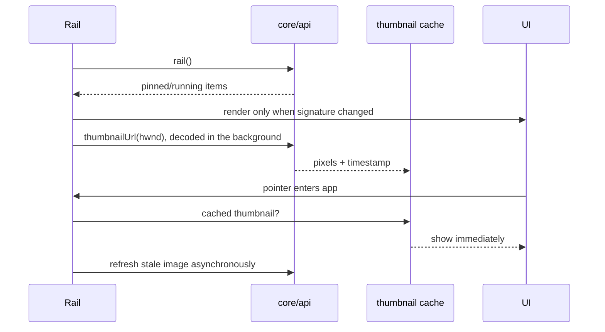

# Taskbar feature

Owns Opaline's optional mirror of pinned and running Windows apps, plus hover thumbnails. It is separate from Opaline destination navigation.

`index.ts` exposes lifecycle (`initRail`, `startRail`, `stopRail`), refresh, compact synchronisation and preview dismissal. `taskbar.css`
owns the rail, running indicators and thumbnail card. Rail refreshes are
signature-compared so unchanged native data does not rebuild DOM or interrupt hover state.

The thumbnail cache holds image URLs, bounded by live handles and a short TTL; each capture has its own URL (`opaline://thumb:<hwnd>:<n>`), decoded up front so a window that cannot be captured shows "Preview unavailable". Closing a window evicts its thumbnail entry. Preview
geometry follows the taskbar's edge: the preview opens on the side of the icon that faces into the screen (above a bottom taskbar, below a top one, beside a side one)
and is clamped on screen.

## Placement

The bar (`#bottom-bar`: Home, the Focus capsule, the navigation group and the app mirror) docks to `railEdge` (bottom, top, left, right) and sits at
the `railAlign` start, centre or end of it. `taskbar.css` owns all of it through `data-rail-edge` and `data-rail-align` on `body`: a top bar makes room by
pushing the page down, a side bar stands on its edge with the page's side padding kept clear of it, the mirror and navigation groups turn into columns, and
the navigation tray opens away from the edge. Magnification and the running indicator follow the axis (`--push-x` / `--push-y`), and a vertical mirror
scrolls natively. Taskbar ends puts the two navigation groups in this bar either side of Home and the mirror, so they travel with it; a Sidebar on the
same side as a side taskbar steps inward.

