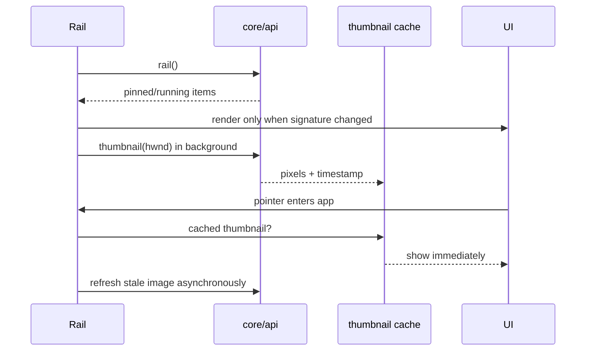

# Taskbar feature

Owns Opaline's optional mirror of pinned and running Windows apps, plus hover thumbnails. It is separate from Opaline destination navigation.

`index.ts` exposes lifecycle (`initRail`, `startRail`, `stopRail`), refresh, compact synchronisation and preview dismissal. `taskbar.css`
owns the rail, running indicators and thumbnail card. Rail refreshes are
signature-compared so unchanged native data does not rebuild DOM or interrupt hover state.

The thumbnail cache is bounded by live handles and a short TTL. Closing a window evicts its thumbnail and window-icon entries. Preview
geometry is currently bottom-edge oriented; four-edge placement must update both rail layout and inward preview clamping together.

